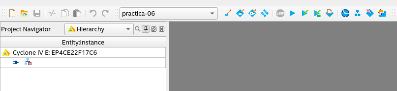
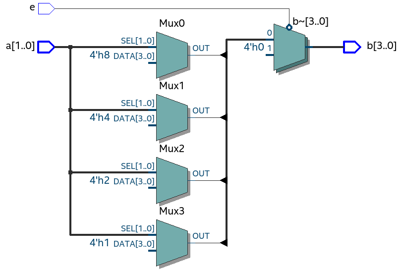
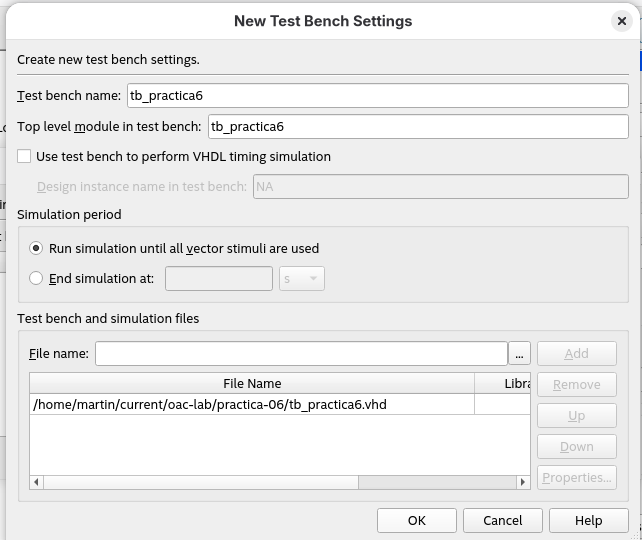
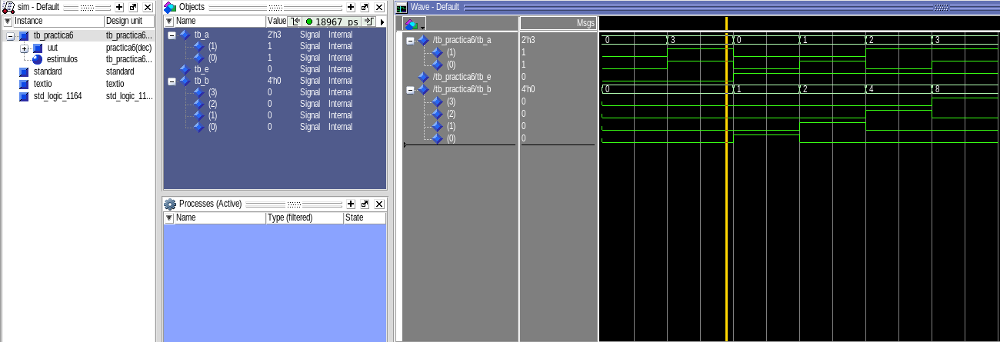

### Objetivo

Generar de diferentes formas un multiplexor ( MUX ) por medio de lenguaje VHDL  utilizando el software Quartus II.

### Desarrollo

Se procede a realizar la práctica siguiendo las convenciones de las prácticas anteriores.

#### 1 - Generación del proyecto



#### 2 - Crear el archivo VHDL de la práctica

Al igual que con la práctica 5. Se usaron diferentes nombres de arquitecturas para apoyarse de un archivo de testbench en el simulador Questa. Para esta práctica se adecua el archivo **practica6.vhd**

```vhdl
-- modelo de un decodificador de 2 a 4
library ieee;
use ieee.std_logic_1164.all; -- Corregido: Se agregó punto y coma

entity practica6 is
	port(
		a: in std_logic_vector ( 1 downto 0 );
		e: in std_logic;
		b: out std_logic_vector ( 3 downto 0 )
	);
end practica6;

architecture dec of practica6 is
begin
	process( a,e )
		begin
			if ( e = '0' ) then
				b <= "0000"; -- Corregido: variable b, comillas dobles y 4 bits
			else
				case a is -- Corregido: se eliminaron los dos puntos
				when "00" => 
					b <= "0001"; -- Corregido: variable b en lugar de o
				when "01" =>
					b <= "0010";
				when "10" => 
					b <= "0100";
				when "11" =>
					b <= "1000";
				when others => 
					b <= "0000";
			end case;
		end if;
	end process;
end dec;
```

Se define **practica6.vhd** como top level entity y se procede a compilar.  Dando los siguientes resultadors en RTL.



#### 3 - Compilación del proyecto

Definimos a **practica6.vhd** como top level entity y pasamos a compilar el proyecto.

#### 4 - Simulación

Para esta entidad se creó el siguiente archivo de testbench **tb_practica6**

```vhdl
library ieee;
use ieee.std_logic_1164.all;

entity tb_practica6 is
end tb_practica6;

architecture test of tb_practica6 is
    -- Señales internas para el testbench
    signal tb_a : std_logic_vector(1 downto 0) := "00";
    signal tb_e : std_logic := '0';
    signal tb_b : std_logic_vector(3 downto 0);
begin
    -- Instancia del decodificador
    uut: entity work.practica6(dec)
    port map (
        a => tb_a,
        e => tb_e,
        b => tb_b
    );

    -- Generación de estímulos
    estimulos: process
    begin
        -- Caso 1: Decodificador deshabilitado (e = '0')
        -- La salida debe mantenerse en "0000" sin importar el valor de 'a'
        tb_e <= '0';
        tb_a <= "00";
        wait for 10 ns;
        tb_a <= "11";
        wait for 10 ns;

        -- Caso 2: Decodificador habilitado (e = '1')
        -- Se prueban las 4 combinaciones posibles de 'a'
        tb_e <= '1';
        tb_a <= "00"; wait for 10 ns; -- Esperado: b = "0001"
        tb_a <= "01"; wait for 10 ns; -- Esperado: b = "0010"
        tb_a <= "10"; wait for 10 ns; -- Esperado: b = "0100"
        tb_a <= "11"; wait for 10 ns; -- Esperado: b = "1000"

        wait; -- Detener simulación
    end process;
end test;
```

Se configura



Y se ejecuta la simulación dando el siguiente resultado en Questa




Donde se confirma que ara cuando el enable **e** vale cero, las salidas son cero, y cuando está en **1** ahora si funcionan las salias multiplexadas.


### Conclusión

Como continuación de la práctica 5, en la que pudimos ver la versatilidad del lenguaje y de las FPGA. En esta práctica se ha elegido la implementación más optima para la arquitectura. observamos que when, nos sirve para aplicar una especie de máscara o filtro para definir la multiplexación de las salidas de manera sencilla.


